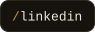
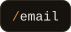
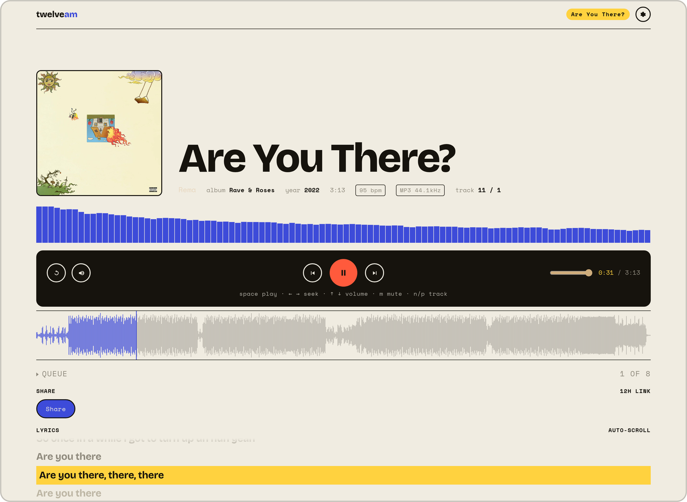
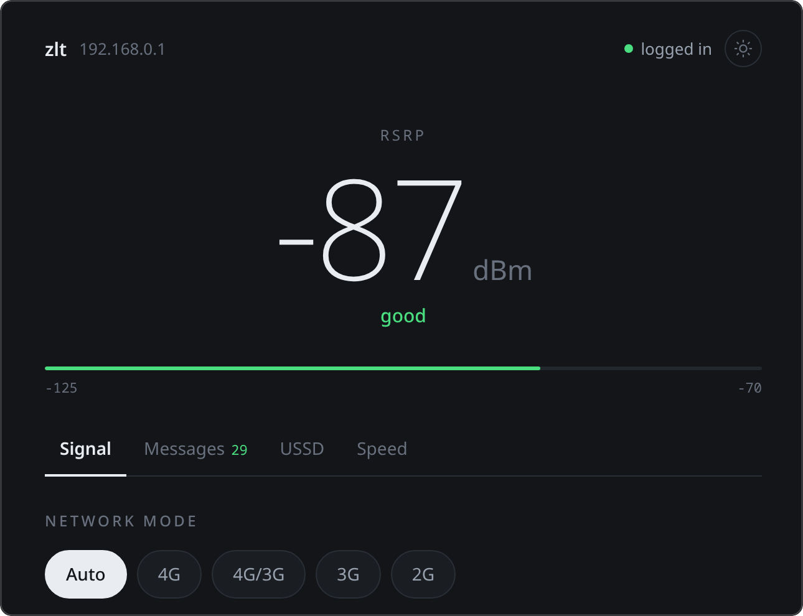

<!-- markdownlint-disable MD033 MD041 -->
<h1 align="center">Abubakar Ismail</h1>

<p align="center">
  <a href="https://exbyte.dev"></a>
</p>

<p align="center">
  <a href="https://exbyte.dev/contact"></a>
  <a href="https://exbyte.dev"></a>
  <a href="https://www.linkedin.com/in/exbyte"></a>
  <a href="mailto:abubakar@exbyte.dev"></a>
</p>

Python backend engineer. I build the backends, integrations and automation that businesses run their operations on. Discord and Telegram bots too, when a project calls for one.

Independent since 2020, with clients worldwide and a 5.0 Top Rated record on Upwork. Founder of [Exbyte Digital Solutions](https://exbyte.dev).

**Currently taking projects.** [Start one here](https://exbyte.dev/contact) or email [abubakar@exbyte.dev](mailto:abubakar@exbyte.dev).

## Things I built that you can use

Most of my client code is private, so this is the work you can open and judge for yourself. I designed, built and maintain all of it on my own.

### [TwelveAM](https://twelveam.xyz): a music player in your browser

<a href="https://twelveam.xyz"></a>

Drop in a song and it plays with a live waveform, a frequency spectrum, synced lyrics and colors pulled from the cover art. The audio is decoded on your device and stays there unless you choose to share it, in which case you get an unguessable link that expires on its own.

No account and nothing to install. It plays MP3, M4A, FLAC, OGG and WAV, and there is a demo track if you have no file handy.

Built with vanilla JS, Web Audio and Vite, with FastAPI, SQLite and nginx behind the share links. [How it's built](https://exbyte.dev/projects/spotify-telegram-bot-twelveam)

### [zltrouter](https://github.com/exbyte-dev/zltrouter): a CLI and dashboard for a router with no API

<a href="https://github.com/exbyte-dev/zltrouter"></a>

The MTN ZLT T10D MAX 4G router has a slow web UI and no documented API. I read the JavaScript it serves, worked out its login and request protocol, and built a CLI and a local dashboard on top: live signal, network mode switching, SMS, USSD and a speed test.

Installs with pipx on Linux, macOS and Windows:

```bash
pipx install zltrouter
```

This one is for people who own that router, which is a small club. If you are not in it, the [protocol notes](https://github.com/exbyte-dev/zltrouter/blob/master/docs/protocol.md) show how the reverse engineering was done, and the project has grown a small family:

- [Router Signal](https://github.com/exbyte-dev/zlt-android), an Android app with a Quick Settings tile and a demo mode that needs no router
- [zlt-gnome](https://github.com/exbyte-dev/zlt-gnome), a signal indicator for the GNOME top bar
- [glorouter](https://github.com/exbyte-dev/glorouter), the same idea for the Huawei B311-221

### Smaller tools and bots

- **[zshup](https://github.com/exbyte-dev/zshup)** sets up zsh in one command: Oh My Zsh, autosuggestions, syntax highlighting and fzf keybindings, with a managed `.zshrc`. Works on Arch, Debian, Ubuntu, Fedora, Termux and macOS.
- **[Quest](https://t.me/qstttbot)** is a Telegram bot for group games: country battles, trivia rallies, a daily Wordle and leaderboards to climb. Add it to a group chat to play. The bot is live; its code is private.
- **[ecoflowbot](https://github.com/exbyte-dev/ecoflowbot)** is a Discord bot for EcoFlow power stations. It watches the station over MQTT, tells you the moment grid power drops or comes back, and lets you check the battery or switch outputs with slash commands. Particularly useful when your servers run on unreliable grid power.

## Client work

Production systems built for clients. The code is private, so the links go to case studies.

**Candor: multi-channel fulfillment dashboard.** One dashboard that keeps orders in sync across Amazon, Shopify and Walmart. Built with FastAPI, React and MongoDB, with Stripe billing, USPS tracking and a pipeline that pulls tracking information out of shipping-label PDFs. [Case study](https://exbyte.dev/projects/multi-channel-fulfillment-dashboard)

**Kryptium: Discord platform backend.** Lead backend engineer on a multi-tenant Discord platform with more than 1,000 active users: event management, in-app currency, and REST APIs for events, wallets and identity. Maintained 99.9% uptime, which I'm quietly proud of. [Case study](https://exbyte.dev/projects/kryptium-discord-backend)

**ShipFlow: automated shipping pipeline.** Monitors Dropbox, generates Shippo labels, handles multi-box orders, and recovers gracefully when something goes wrong. Because in production, something eventually does.

More on the [projects page](https://exbyte.dev/projects).

## What I work with


- **Backend:** Python, FastAPI, Django, async systems, REST APIs, webhooks, pytest
- **Data:** PostgreSQL, MongoDB, Redis
- **Infrastructure:** Linux, Docker, Nginx, Cloudflare, CI/CD, VPS deployment
- **Integrations:** Marketplace, shipping and payment APIs, MQTT, OpenAI, LangChain, ElevenLabs
- **Bots:** py-cord, python-telegram-bot

## A bit about me

I've been building software since 2018. I like backend systems, undocumented APIs, automating tedious processes, and tools that solve problems I actually have. Outside client work, I'm usually building one of those for myself.

## Find me

- **Website:** [exbyte.dev](https://exbyte.dev)
- **LinkedIn:** [linkedin.com/in/exbyte](https://www.linkedin.com/in/exbyte)
- **Email:** [abubakar@exbyte.dev](mailto:abubakar@exbyte.dev)
